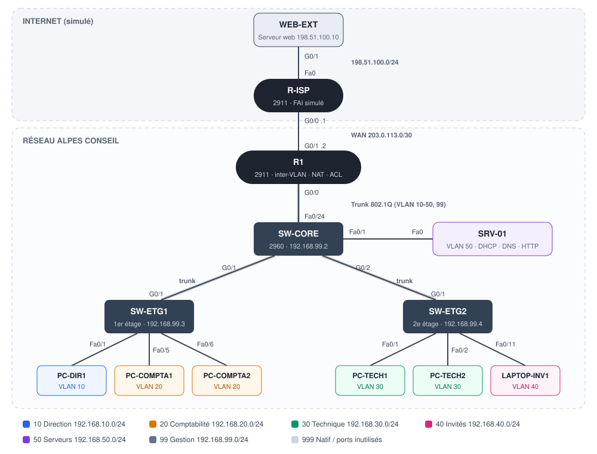

# Architecture réseau d'entreprise · Cisco Packet Tracer

Conception et configuration du réseau d'une PME fictive, **Alpes Conseil** (quatre services répartis sur deux étages),
avec Cisco Packet Tracer.

Objectifs du projet :
- séparer les services avec des **VLAN** et les faire communiquer avec un **routage inter-VLAN** ;
- distribuer les adresses avec un **serveur DHCP** central et résoudre les noms avec un **DNS** interne ;
- donner accès à Internet grâce au **NAT/PAT** ;
- **sécuriser** le réseau : ACL entre les services, accès SSH limité, port-security, ports inutilisés désactivés.

## Topologie



| Équipement | Modèle | Rôle |
|---|---|---|
| R1 | Cisco 2911 | routage inter-VLAN (router-on-a-stick), NAT, ACL, relais DHCP |
| R-ISP | Cisco 2911 | simule le fournisseur d'accès Internet |
| SW-CORE | Cisco 2960 | switch central, relie le routeur, le serveur et les étages |
| SW-ETG1 | Cisco 2960 | switch d'accès du 1er étage (Direction, Comptabilité) |
| SW-ETG2 | Cisco 2960 | switch d'accès du 2e étage (Technique, Invités) |
| SRV-01 | Server-PT | DHCP, DNS et intranet web |
| WEB-EXT | Server-PT | site web placé « sur Internet » pour tester l'accès extérieur |

## VLAN et plan d'adressage

| VLAN | Nom | Réseau | Passerelle | Plage DHCP |
|---|---|---|---|---|
| 10 | DIRECTION | 192.168.10.0/24 | 192.168.10.1 | .100 à .199 |
| 20 | COMPTABILITE | 192.168.20.0/24 | 192.168.20.1 | .100 à .199 |
| 30 | TECHNIQUE | 192.168.30.0/24 | 192.168.30.1 | .100 à .199 |
| 40 | INVITES | 192.168.40.0/24 | 192.168.40.1 | .100 à .149 |
| 50 | SERVEURS | 192.168.50.0/24 | 192.168.50.1 | adresses fixes |
| 99 | GESTION | 192.168.99.0/24 | 192.168.99.1 | adresses fixes |
| 999 | INUTILISES | — | — | VLAN natif des trunks et ports désactivés |

| Équipement | Interface | Adresse |
|---|---|---|
| R1 | G0/0.10 à G0/0.50 | 192.168.X.1 (X = numéro du VLAN) |
| R1 | G0/0.99 | 192.168.99.1 |
| R1 | G0/1 (WAN) | 203.0.113.2/30 |
| R-ISP | G0/0 | 203.0.113.1/30 |
| R-ISP | G0/1 | 198.51.100.1/24 |
| SW-CORE | VLAN 99 | 192.168.99.2 |
| SW-ETG1 | VLAN 99 | 192.168.99.3 |
| SW-ETG2 | VLAN 99 | 192.168.99.4 |
| SRV-01 | Fa0 | 192.168.50.10 |
| WEB-EXT | Fa0 | 198.51.100.10 |

Les adresses 203.0.113.0/30 et 198.51.100.0/24 sont des plages réservées à la documentation (RFC 5737),
utilisées ici pour représenter des adresses publiques.

## Services

- **DHCP** : un seul serveur (SRV-01) pour tous les VLAN. Les demandes DHCP sont des broadcasts qui ne traversent
  pas le routeur : la commande `ip helper-address 192.168.50.10` sur chaque sous-interface de R1 les relaie vers le serveur.
- **DNS** : `intranet.alpes.local` pointe vers le serveur interne, `www.site-externe.com` vers le serveur « Internet ».
- **NAT/PAT** : tous les réseaux internes sortent sur Internet avec l'adresse publique de R1 (203.0.113.2).
  Le FAI n'a donc besoin d'aucune route vers les réseaux privés.

## Sécurité

| Mesure | Où | Effet |
|---|---|---|
| ACL `INVITES` | R1, entrée de G0/0.40 | les invités n'accèdent qu'à Internet (plus le DHCP et le DNS) |
| ACL `COMPTA` | R1, sortie de G0/0.20 | seuls la Direction et les serveurs peuvent ouvrir une connexion vers la comptabilité |
| SSH v2 uniquement | R1 et switchs | Telnet désactivé, comptes locaux, mots de passe chiffrés |
| `access-class 10` | lignes VTY | administration possible seulement depuis le VLAN Technique |
| VLAN de gestion 99 | switchs | administration séparée du trafic des utilisateurs, VLAN 1 désactivé |
| Port-security | ports d'accès | 2 adresses MAC maximum par port (1 pour les invités), apprises en sticky |
| BPDU Guard + PortFast | ports d'accès | un switch branché sur une prise utilisateur coupe le port |
| Ports inutilisés | tous les switchs | placés dans le VLAN 999 et désactivés |
| VLAN natif 999 | trunks | évite d'utiliser le VLAN 1 par défaut (protection contre le VLAN hopping) |
| DTP désactivé | trunks | `switchport nonegotiate` |

## Contenu du dépôt

```
├── alpes-conseil.pkt          fichier Packet Tracer
├── configs/
│   ├── R1.txt                 configurations complètes à coller dans la CLI
│   ├── R-ISP.txt
│   ├── SW-CORE.txt
│   ├── SW-ETG1.txt
│   ├── SW-ETG2.txt
│   └── serveurs-et-postes.md  configuration des serveurs (DHCP, DNS, HTTP) et des postes
└── docs/
    ├── topologie.svg
    ├── construction.md        placement des équipements, câblage, ordre de configuration
    └── tests.md               plan de tests et résultats attendus
```

## Ouvrir le projet

Ouvrir `alpes-conseil.pkt` avec **Cisco Packet Tracer 8.x**.
Pour reconstruire la maquette de zéro, suivre [docs/construction.md](docs/construction.md).

Identifiants de la maquette : `admin` / `Admin@2026` (enable : `Alpes@2026`).

## Tests

Le plan de tests complet est dans [docs/tests.md](docs/tests.md). Il vérifie notamment :
- l'attribution des adresses par DHCP dans chaque VLAN ;
- la communication entre VLAN et l'accès à l'intranet ;
- l'accès à Internet et les traductions NAT ;
- le blocage des invités vers le réseau interne et de la Technique vers la Comptabilité ;
- l'accès SSH aux équipements uniquement depuis le VLAN Technique.

## Pistes d'amélioration

- Redondance : deuxième switch central et deuxième lien vers le routeur (EtherChannel), HSRP avec un deuxième routeur
- Remplacer le router-on-a-stick par un switch de niveau 3 pour le routage inter-VLAN
- Ajouter un point d'accès Wi-Fi pour le VLAN invités
- Centraliser les journaux avec un serveur Syslog et synchroniser l'heure avec NTP
